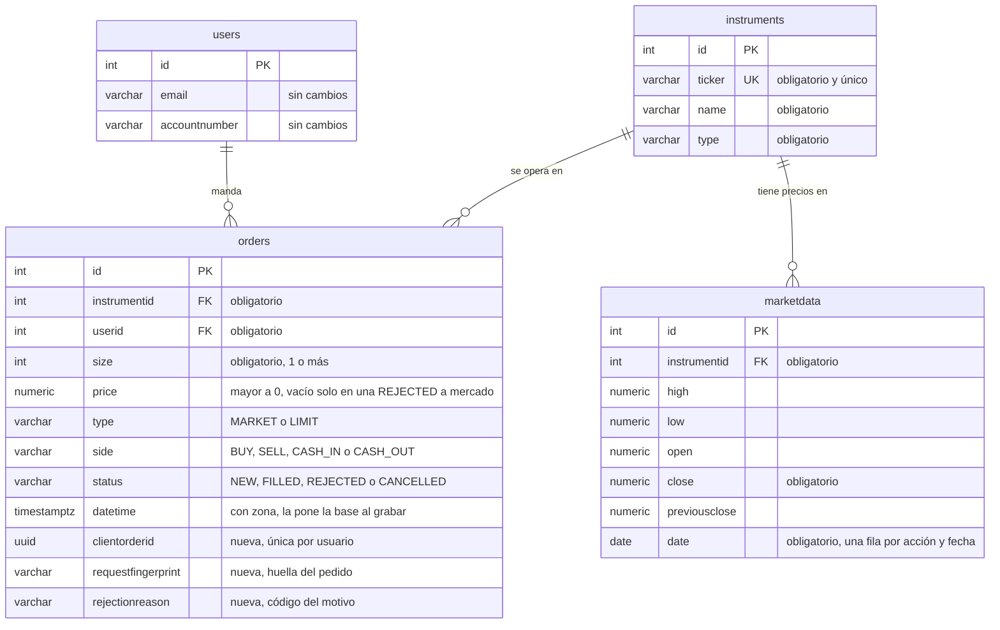

# 03 — RFC: cómo se construye la API

> Fase 3 · 2026-11-07 · Estado: **en construcción, por secciones**
>
> El PRD ([`02-prd.md`](02-prd.md)) dice qué tiene que hacer la API; este documento dice cómo se construye. Cubre lo
> que el PRD dejó para esta fase (su sección 6) y los cambios a la base que quedaron pendientes en
> [`01-decisiones.md`](01-decisiones.md). Los códigos entre paréntesis remiten a esos documentos: A-4 o R-2, al
> análisis; ENV-9 o GEN-1, al PRD. Cada decisión grande tiene además un ADR en la carpeta [`adr/`](adr/), con las
> opciones que se evaluaron. La sección 12 reúne las decisiones de esta fase.

## Resumen

_Se escribe al final, con todo decidido: el diseño en media página y un diagrama de quién llama a quién._

## 1. Contexto y principios

**Qué se construye.** Una API HTTP en Java con cinco funciones: portfolio, búsqueda de activos y envío de órdenes,
que pide el enunciado, más cancelación y listado de órdenes, que se agregaron en el análisis (A-7). Trabaja sobre la
base que mandó Cocos: usuarios, instrumentos, precios y órdenes. Qué hace cada función, y con qué casos se prueba,
está en el PRD. Esta sección junta lo que condiciona el cómo y los criterios para decidirlo.

**Lo que condiciona el diseño**

| Condición | De dónde sale | Qué implica |
|---|---|---|
| **Java** | el mail de Cocos, que pisa el Node.js del enunciado (C-1) | el lenguaje está dado; el framework y las librerías se eligen en la sección 2 |
| **Se ejecuta localmente con un comando** | el mail, GEN-2 | todo se levanta con `docker compose up`, y alcanza con tener Docker |
| **La base ya existe y tiene datos** | el enunciado; `database.sql`, idéntico a Neon: 4 usuarios, 66 instrumentos, 126 precios y 11 órdenes | se cambia con migraciones y solo donde se justifica. Los datos heredados no se corrigen (D-1, D-4, D-6), así que cada regla nueva tiene que convivir con los que ya están |
| **Neon se trata como producción** | "Base de Neon" | la API y los tests corren contra una copia local en Postgres 18, la misma versión mayor que Neon; los tests nunca tocan Neon. La dirección de la base se configura, y si a Neon se le aplican las migraciones se decide en la fase 8 |
| **Sin autenticación** | el enunciado (S-5) | el número de usuario viaja en cada pedido; en producción saldría de la sesión |
| **No se simula el mercado** | el enunciado | una orden a mercado se resuelve en el momento, al último precio; una límite aceptada queda pendiente hasta que el usuario la cancela. No hay horario de mercado ni vencimientos |
| **Hoy hay 11 órdenes, pero el diseño tiene que aguantar volumen** | "Esquema: se mejora", A-4, A-7, GEN-8 | cada consulta se piensa para mucho volumen y se mide, como en el análisis, con un millón de órdenes |
| **Test funcional del envío** | el enunciado, GEN-3 | el envío se prueba de punta a punta contra una base real, con los casos del PRD |

**Principios**

Cuando hay que elegir entre opciones que cumplen el PRD, se decide con estos criterios. El orden importa: si dos
chocan, gana el de más arriba.

1. **La plata y las acciones nunca se gastan dos veces,** ni con dos órdenes al mismo tiempo (R-1) ni con un
   reintento (R-2). Es el riesgo más serio del challenge: la orden 11, que dejó BMA en −10, es el síntoma exacto de
   dos ventas simultáneas sin bloqueo (D-1). Una opción más simple que deje abierta esa puerta no sirve.
2. **Nunca se cambia lo que el usuario autorizó.** Un precio con más de 2 decimales se rechaza en vez de redondearse
   (D-4), y en una orden por monto la cantidad se corta para abajo, así nunca supera lo pedido (A-6).
3. **La base no acepta datos imposibles.** Las reglas que se ven en una sola fila, como una orden sin usuario o un
   lado que no existe (`side = 'COMPRA'`), van en la base. Las que necesitan sumar muchas filas, como "no vender más
   de lo que se tiene", van en el código (D-1).
4. **Cada dato vive en un solo lugar.** Las posiciones se calculan desde las órdenes y no se copian a otra tabla, así
   no hay dos versiones que puedan diferir (A-4).
5. **Lo que se afirma, se mide o se prueba.** Un índice entra con su medición antes y después (A-4, A-7), y los casos
   del PRD son la base de los tests (sección 10).
6. **Lo simple gana.** Entre dos opciones que cumplen lo anterior, va la más simple. Cada capa, patrón o librería
   extra se justifica en un ADR, o no entra (`CLAUDE.md`).

## 2. Arquitectura

**Versiones**

| Pieza | Versión | Por qué |
|---|---|---|
| Java | 25, de soporte largo (LTS) | Es la LTS vigente, con soporte hasta septiembre de 2031. La anterior, 21, también serviría, pero su soporte termina en diciembre de 2029. Las que salieron después, 26 y 27, no son LTS y duran 6 meses |
| Spring Boot | 4.1 (la 4.1.2 al 2026-11-07) | Es la línea estable, con soporte gratuito hasta julio de 2027. La 3.5 lo perdió en junio de 2026, la 4.0 lo pierde en diciembre y la 4.2 todavía está en prueba |
| Postgres | 18 | La misma versión mayor que Neon (18.6) |

Encajan entre sí: Spring Boot 4.1.2 pide Java 17 o más y soporta hasta Java 27, y JaCoCo, que mide la cobertura
(sección 10), soporta Java 25 desde su versión 0.8.14. Verificado el 2026-11-07 en endoflife.date
([Spring Boot](https://endoflife.date/spring-boot), [Temurin](https://endoflife.date/eclipse-temurin)), en los
[requisitos de Spring Boot](https://docs.spring.io/spring-boot/system-requirements.html), en los anuncios de la 4.2
([M2](https://spring.io/blog/2026/09/25/spring-boot-4-2-0-M2-available-now/),
[RC1](https://infoq.com/news/2026/10/spring-news-roundup-oct19-2026)) y en los
[cambios de JaCoCo](https://www.jacoco.org/jacoco/trunk/doc/changes.html).

**Por qué Spring Boot.** Trae resuelto casi todo lo que pide la vara de calidad de `CLAUDE.md`: validación de lo que
llega (Bean Validation), errores con formato estándar (Problem Details), métricas (Micrometer y Actuator), logs
estructurados, transacciones, acceso a la base con `JdbcClient` y tests contra un Postgres real con Testcontainers.
Quarkus y Micronaut arrancan más rápido y usan menos memoria: son ventajas cuando se levantan y apagan muchas
instancias por minuto, no en una API que queda corriendo.

**Estilo: capas, agrupadas por función** ([ADR 0001](adr/0001-capas-por-funcion.md))

Cada función tiene tres capas, y cada capa hace una sola cosa:

| Capa | Qué hace | Qué no hace |
|---|---|---|
| controller | recibe el pedido HTTP, valida su forma y arma la respuesta | no aplica reglas de negocio ni toca la base |
| service | abre la transacción, aplica las reglas y decide el resultado, por ejemplo `FILLED` o `REJECTED` | no escribe SQL ni conoce HTTP |
| repository | ejecuta el SQL y convierte cada fila en un record de Java | no decide nada |

- **Los cálculos van en clases de Java puro,** sin Spring ni base: pesos disponibles, PPC, rendimiento, cantidad por
  monto y reservas. Se prueban con tests unitarios, rápido y caso por caso.
- **La cuenta del usuario se calcula en un solo lugar,** el paquete `account`: pesos, reservas, disponibles y
  posiciones. La usan el portfolio y el envío (principio 4). Si cada uno tuviera su fórmula, el portfolio podría
  mostrar $627.500 disponibles y el envío validar contra otro número. Si se calcula en la base o en Java se decide en
  la sección 4.
- **El catálogo de activos y sus precios viven en `instruments`,** junto con la búsqueda: el portfolio, el envío y la
  búsqueda leen el último precio del mismo lugar.
- **Lo común** (el formato de los errores, el id de cada pedido y la configuración) va en `shared`.
- **Las dependencias van en un solo sentido:** controller → service → repository, y de cada función hacia `account` e
  `instruments`, nunca al revés. Los cálculos no dependen de nada.


`shared` no aparece en el diagrama porque lo usan todos.

**Por qué no hexagonal** (ni Clean Architecture, que sigue la misma idea). Sus interfaces ("puertos") sirven para
cambiar lo de afuera sin tocar el núcleo, y acá lo único de afuera es la base. Lo más delicado, la transacción del envío, se prueba contra Postgres real de todas formas.
Cambiaría si la API mandara órdenes a un mercado real: ahí se agrega un puerto para el mercado, no toda la
arquitectura.

**Acceso a datos: SQL directo con `JdbcClient`** ([ADR 0002](adr/0002-sql-directo-con-jdbcclient.md))

Cada repository escribe su SQL con `JdbcClient`, que viene con Spring: Spring maneja las conexiones, los parámetros y
las transacciones, y convierte cada fila en un record. Las transacciones se marcan en los services. El SQL verificado
en el análisis es el punto de partida.

**Por qué no JPA.** Las consultas importantes de esta API (sumas con condiciones, `unaccent`, el cursor, los
bloqueos) terminarían en SQL nativo igual, y JPA agrega comportamiento escondido justo en el camino más delicado. Por
ejemplo, cancelar en un solo paso (A-7) es un `UPDATE ... WHERE status = 'NEW'`; con JPA, lo habitual es leer la
orden, cambiarla en memoria y grabarla al confirmar. jOOQ validaría el SQL al compilar, pero obliga a generar código
en cada build: para unas 10 consultas no se justifica.

**Recorrido de un pedido**

El envío de una orden es el recorrido más completo:

1. **Llega el pedido.** Un filtro le asigna un id, que acompaña a todos los logs de ese pedido (sección 8).
2. **El controller valida la forma:** que estén los datos y con valores válidos, que venga la cantidad o el monto (uno
   de los dos), que la cantidad sea entera y mayor a 0, que montos y precios sean mayores a 0 y con hasta 2 decimales,
   y que la combinación tenga sentido (una límite lleva precio; una a mercado, no). Si algo falla, responde 400 con el
   error en formato estándar (sección 7), y no se graba nada.
3. **El service abre una transacción** y, dentro de ella:
   1. toma el turno del usuario, para que sus órdenes se procesen de a una (sección 5);
   2. se fija si el identificador de la orden ya existe: si es un reintento con el mismo contenido, devuelve la orden
      original, y con otro contenido, da error (sección 5);
   3. le pide la cuenta del usuario a `account` y el activo con su último precio a `instruments`;
   4. si con esos datos no se puede armar la orden (el activo no existe o es ARS, o por monto la cantidad da 0), da
      error y no graba nada (A-6). Si se puede, los cálculos deciden el resultado: `FILLED`, `NEW` o `REJECTED`, con
      su motivo;
   5. graba la orden.
4. **Los repositories** ejecutan cada paso en SQL, dentro de esa misma transacción.
5. **El controller responde** con la orden y su estado (sección 6), y las métricas la cuentan por tipo, lado y estado
   (sección 8).

**Qué queda para el plan.** Este RFC fija los paquetes, qué hace cada capa y las reglas que el código tiene que
cumplir. Las clases y los archivos concretos los define el plan de implementación (fase 4), tarea por tarea y con el
test de cada una primero.

## 3. Modelo de datos y cambios a la base

El modelo de Cocos se mantiene: las cuatro tablas, sus columnas y sus nombres (C-2). Los cambios son de tres tipos:

- **reglas,** para que la base no acepte datos imposibles (principio 3);
- **tres columnas nuevas** en `orders`, para el identificador de la orden y el motivo del rechazo (R-2, A-6);
- **un índice,** con su medición antes y después (principio 5).

Todo se probó en la copia local (Postgres 18.6, con `database.sql`). La forma exacta está en
[`mediciones/03-esquema.sql`](mediciones/03-esquema.sql), el borrador verificado del que sale la migración de la
fase 5. Cómo se aplican las migraciones, y qué pasa con Neon, es la parte 2 de esta sección (3.6).

### 3.1 El modelo, con los cambios



### 3.2 Reglas

Cada regla mira una sola fila. Las que necesitan sumar muchas filas, o mirar otra tabla, van en el código (principio
3, D-1).

| Tabla | Regla | Por qué |
|---|---|---|
| `orders` | Obligatorios: activo, usuario, cantidad, tipo, lado, estado y fecha | una orden sin usuario o sin cantidad no se puede calcular (E-1) |
| `orders` | El lado, el tipo y el estado, solo con los valores del enunciado | `side = 'COMPRA'` es un dato imposible (E-2) |
| `orders` | Cantidad de 1 o más | una orden de 0 acciones nunca se graba (A-6) |
| `orders` | Precio mayor a 0, y vacío solo en una `REJECTED` a mercado | una orden a mercado sobre un activo sin cotización queda sin precio (A-6). Con precio mayor a 0, el costo nunca es cero (A-2, R-4) |
| `orders` | En depósitos y retiros (`CASH_IN`, `CASH_OUT`), precio 1 | `size × price` es el monto en pesos: con precio 2, un depósito de $1.000 valdría $2.000 (D-9) |
| `orders` | El identificador es único por usuario, y viaja con su huella: están las dos o ninguna | un reintento no crea otra orden, y dos usuarios pueden usar el mismo identificador (R-2) |
| `orders` | El motivo del rechazo: uno de los tres códigos, y solo en una `REJECTED` | un motivo de rechazo en una orden ejecutada no tiene sentido (A-6) |
| `instruments` | Ticker, nombre y tipo obligatorios; el ticker, único | la búsqueda y el portfolio muestran el ticker, y dos activos con el mismo serían ambiguos (E-1, E-3) |
| `marketdata` | Activo, fecha y cierre obligatorios; una fila por acción y fecha | el último precio es el cierre de la fecha más reciente, y tiene que haber uno solo (D-3) |
| `marketdata` | Precios mayores a 0; mínimo menor o igual al máximo; apertura y cierre entre los dos | un precio de $0, o un mínimo mayor al máximo, son imposibles (D-5) |

`users` no cambia: la API solo verifica que el usuario exista. El tipo de activo no se limita a `ACCIONES` y
`MONEDA`: el catálogo podría sumar bonos o CEDEAR, y la API solo distingue la moneda del resto.

**Conviven con los datos de hoy.** Cada regla se probó contra las 11 órdenes, los 66 activos y los 126 precios, y los
datos cumplen todas. Por eso se agregan verificadas, sin `NOT VALID`, la opción de Postgres que agrega una regla sin
revisar las filas que ya existen. La única regla que los datos rompen, "la posición no puede quedar negativa", no va
en la base (D-1).

**Lo que queda en el código**

| Regla | Por qué no va en la base |
|---|---|
| No vender más de lo que se tiene | depende de la suma de muchas filas, y BMA ya está en −10 (D-1) |
| Toda orden nueva trae identificador | las 11 viejas no lo tienen, y `NOT VALID` no sirve: Postgres vuelve a verificar la regla cuando se modifica una fila vieja, así que cancelar la orden 7 fallaría (probado). La API responde 400 si falta (R-2) |
| Toda `REJECTED` tiene motivo | la orden 6, vieja, no lo tiene. Lo asegura la API, con un test |
| Solo se cancela una orden `NEW` | compara la fila antes y después del cambio. Va en el `UPDATE` de la cancelación, que solo cambia la orden si sigue `NEW` (A-7) |
| Depósitos y retiros solo sobre ARS, y ARS no se compra ni se vende | hay que mirar otra tabla (D-9, A-6) |

**Lo que no entra en las columnas.** Un precio de más de $99.999.999,99 no entra en `price` (`NUMERIC(10,2)`), y una
cantidad de más de 2.147.483.647 no entra en `size` (`INT`). Por ejemplo, $15.100 millones por monto en CARC, a $7,
dan 2.157 millones de acciones. Sin validación, esa orden no queda `REJECTED`: la base falla y la respuesta sería un
500. La API valida esos topes antes de grabar y responde 400 (sección 7). Los tipos no se amplían: ninguna orden real
se acerca a esos números, y los precios se quedan en 2 decimales (D-4).

### 3.3 Columnas nuevas en `orders`

| Columna | Tipo | Qué guarda | En las 11 órdenes viejas |
|---|---|---|---|
| `clientOrderId` | `uuid` | el identificador que pone la app en cada orden (R-2) | vacía |
| `requestFingerprint` | `varchar(64)` | la huella del pedido: un resumen de sus datos (SHA-256, en hexadecimal) | vacía |
| `rejectionReason` | `varchar(30)` | el motivo del rechazo: `INSUFFICIENT_CASH`, `INSUFFICIENT_SHARES` o `NO_MARKET_PRICE` | vacía, también en la orden 6 (LIS-4) |

Siguen la convención de las columnas de Cocos: se escriben `clientOrderId` y Postgres las guarda en minúsculas
(`clientorderid`), igual que `instrumentId`. Con `client_order_id` habría dos convenciones en la misma tabla.

- **El identificador es un UUID,** por ejemplo `3f2b8c1e-9d4a-4c7b-8e21-5a6f0b9c2d13`. Lo genera la app y el usuario
  nunca lo ve (R-2). En Postman sale con `{{$guid}}`, y desde una terminal, con `uuidgen`. Tiene largo fijo, así que
  cierra el "largo máximo" de ENV-9. Un texto libre, como el `ClOrdID` de FIX, sería más flexible, pero obligaría a
  fijar un largo y qué caracteres valen, y "abc" y "ABC" serían dos identificadores distintos.
- **La huella compara el contenido de un reintento.** El mismo pedido da la misma huella, aunque el precio haya
  cambiado entre el envío y el reintento. Guardar el pedido tal cual, en JSON, se leería mejor, pero copiaría el
  activo, el lado y el tipo, que ya están en la orden (principio 4), y guardaría el monto pedido, que A-6 decidió no
  guardar. Qué datos entran en la huella se define en la sección 5.
- **El motivo es un código, no un texto.** El texto que ve el usuario ("no alcanzan los pesos") lo arma la API
  (sección 7), y la métrica de rechazos por motivo (GEN-4) cuenta por código. Con texto libre, "no alcanzan los pesos"
  y "fondos insuficientes" contarían como dos motivos distintos.
- **No se guarda cuándo cambió el estado** (A-7 lo dejaba como candidato). El PRD no lo muestra, la orden 3, que está
  cancelada, quedaría con la fecha vacía, y una columna guarda solo el último cambio. Para auditar haría falta un
  historial de cambios, que queda como mejora posible.

### 3.4 La fecha y hora de las órdenes

- **Pasa a fecha y hora con zona** (`timestamptz`), leyendo las fechas existentes como hora argentina (D-10). La
  conversión nombra la zona (`AT TIME ZONE 'America/Argentina/Buenos_Aires'`), y la orden 2 sigue a las 12:31 de
  Buenos Aires. Con la conversión simple, la base usaría la zona de la sesión, que en Neon es GMT, y la orden 2
  quedaría a las 9:31, con el mercado cerrado (probado).
- **La pone la base al grabar la orden, con `clock_timestamp()`.** Es un solo reloj aunque haya varias instancias de
  la API. Y como la orden se graba dentro del turno del usuario (sección 5), el orden por fecha es el orden en que se
  procesaron sus órdenes, del que depende el PPC (A-2). `now()`, lo más común, no sirve: es la hora en que empezó la
  transacción, antes de esperar el turno (probado: quedó fija mientras pasaban 1,5 segundos). Esto precisa D-10, que
  decía "el momento en que se recibe": es el momento en que se graba, milisegundos después.
- **Guarda microsegundos.** La respuesta del envío y el cursor del listado usan la fecha tal como quedó grabada
  (sección 6), así no se pierde precisión al pasar de página (A-7).

### 3.5 Índices

**Cómo se midió.** En la copia local, con este esquema y 2.010.011 órdenes inventadas:

- 10.000 usuarios típicos, de 100 órdenes cada uno;
- uno pesado, de 10.000;
- uno extremo, de 1.000.000, que sirve para ver dónde está el límite: ningún inversor común llega a eso.

Cada consulta corrió 7 veces (el portfolio del extremo, 3) y se toma la mediana. Son números de una laptop con los
datos en memoria: sirven como orden de magnitud. Los scripts están en [`mediciones/`](mediciones/); la salida
completa de la corrida, en [`mediciones/03-resultados.md`](mediciones/03-resultados.md); y al final de esta parte
está cómo repetirla.

**Hoy, sin índices, cualquier consulta lee las 2 millones de órdenes:** tarda entre 33 y 55 ms aunque el usuario
tenga 100, y el tiempo crece con la tabla. Con un índice por **(usuario, fecha, id)**:

| Consulta | Típico (100) | Pesado (10.000) | Extremo (1.000.000) |
|---|---|---|---|
| Portfolio y cuenta del envío: las órdenes `FILLED` y `NEW`, en orden | 54 → 0,017 ms | 55 → 1,2 ms | 304 → 175 ms |
| Listado, primera página | 33 → 0,006 ms | 35 → 0,006 ms | 91 → 0,007 ms |
| Listado, última página (cursor) | 40 → 0,007 ms | 41 → 0,007 ms | 42 → 0,007 ms |
| Pendientes (filtro `NEW`) | 40 → 0,012 ms | 40 → 0,7 ms | 42 → 131 ms |
| Rechazadas (filtro `REJECTED`) | 40 → 0,012 ms | 39 → 0,026 ms | 48 → 0,029 ms |

- **El listado queda instantáneo para cualquier usuario, en cualquier página.** El índice tiene el orden que
  necesita el cursor de A-7 para ir directo a donde quedó. El índice del identificador (R-2) también empieza por el
  usuario y ya ayuda algo (el portfolio del pesado, 3,2 ms), pero no está ordenado por fecha: con él, el listado del
  extremo tarda 91 ms.
- **Las pendientes del extremo empeoran,** de 42 a 131 ms. Con el índice, la base recorre en orden su millón de
  órdenes buscando sus 8 pendientes, y eso es más lento que leer de corrido toda la tabla de esta prueba. Con una
  tabla más grande, ganaría el índice.
- **El portfolio es la consulta más cara de cada usuario, y ningún índice lo baja de ahí.** El del extremo lee unas
  850.000 órdenes ejecutadas y pendientes. Es el límite conocido de calcular desde las órdenes (A-4), y la salida es
  la foto a una fecha, documentada como evolución posible.

**Alternativas medidas.** A-7 había decidido un índice por (usuario, estado, fecha, id) para el filtro por estado.
Se descarta, igual que las otras dos opciones:

| Alternativa | Qué mejora | Qué cuesta |
|---|---|---|
| Sumar (usuario, estado, fecha, id), el de A-7 | pendientes del extremo: 131 → 0,006 ms | es el índice más grande: 95 MB, contra 78 del de fecha, en una tabla de 342. Cada alta pasa de 19 a 25 microsegundos, un 30 % más |
| Usar solo (usuario, estado, fecha, id), sin el de fecha | lo mismo | el listado sin filtro del extremo vuelve a 83 ms |
| Sumar un índice parcial, que guarda solo las pendientes | pendientes del extremo: 131 → 0,005 ms, con 2 MB y casi sin costo en las altas (20 microsegundos, contra 19) | solo se usa si la consulta lleva `'NEW'` escrito en el SQL. Cuando una consulta se repite mucho, Postgres puede pasar a un plan general, que no sabe qué estado se pide, y ese plan no lo usa (probado: 128 ms) |

Ninguna amplía los usuarios que la API aguanta. **Las pendientes siempre cuestan menos que el portfolio del mismo
usuario** (0,7 contra 1,2 ms en el pesado; 131 contra 175 ms en el extremo), y ninguna de las tres mejora el
portfolio. Esto cambia la decisión 7 de A-7. **Cuándo revisarlo:** si se hace la foto a una fecha, el portfolio deja
de leer todo el historial y las pendientes pasan a ser la consulta más lenta. Ahí se suma el índice parcial, con
`'NEW'` escrito en el SQL.

**Las otras tablas**

- **`marketdata`:** el índice viene con la regla "una fila por acción y fecha". Con 10 años de precios diarios
  (164.430 filas), el último precio de 20 acciones, buscado acción por acción, tarda 0,06 ms con el índice y 91 ms
  sin él. Con `DISTINCT ON` sobre toda la tabla, como en el anexo del análisis, tarda 88 ms aunque el índice exista:
  la consulta tiene que buscarlo acción por acción (sección 4).
- **Búsqueda:** sin índice, como anticipaba A-5. Tarda 0,06 ms con los 65 activos y entre 11 y 17 ms con un catálogo
  inventado de 10.000. Si el catálogo creciera tanto, la mejora sería un índice de trigramas (`pg_trgm`) sobre el
  ticker y el nombre sin acentos. Queda como evolución posible.
- **`orders.instrumentid`:** sin índice. Postgres no crea solo los índices de las claves foráneas, y este solo
  serviría para borrar activos o para buscar las órdenes de un activo entre todos los usuarios, y la API no hace
  ninguna de las dos cosas. Con 2 millones de órdenes, borrar un activo tarda 73 ms, porque revisa todas.

**Extensiones.** Se instala `unaccent`, para buscar sin acentos (A-5). `pg_trgm` no hace falta.

**Cómo repetir la medición.** En una copia descartable, nunca en Neon. Tarda unos minutos. La espera pregunta por
red (`-h 127.0.0.1`) porque, al arrancar, la imagen de Postgres levanta un servidor provisorio que solo escucha
localmente y después lo reinicia: preguntando sin red, el script puede encontrarlo y fallar.

```bash
docker run --rm -d --name cocos-medicion-pg18 -e POSTGRES_PASSWORD=medicion postgres:18
until docker exec cocos-medicion-pg18 pg_isready -h 127.0.0.1 -U postgres -q; do sleep 1; done
docker exec -i cocos-medicion-pg18 psql -U postgres -X -q -v ON_ERROR_STOP=1 < docs/00-fuentes/database.sql
docker exec -i cocos-medicion-pg18 psql -U postgres -X -q -v ON_ERROR_STOP=1 < docs/mediciones/03-esquema.sql
docker exec -i cocos-medicion-pg18 psql -U postgres -X < docs/mediciones/03-indices.sql
docker exec -i cocos-medicion-pg18 psql -U postgres -X < docs/mediciones/03-precios-y-busqueda.sql
docker stop cocos-medicion-pg18
```

### 3.6 Migraciones y Neon

**La herramienta: Flyway.** Viene integrada con Spring Boot: con `spring-boot-starter-flyway` y el módulo
`flyway-database-postgresql`, Spring Boot 4.1.2 trae Flyway 12.4.0. Cada migración es un archivo SQL numerado
(`V2__....sql`) que se lee tal cual: el mismo SQL de [`mediciones/03-esquema.sql`](mediciones/03-esquema.sql). Flyway
anota en una tabla propia, `flyway_schema_history`, qué migraciones se aplicaron, y detecta si alguna se editó
después.

- **Liquibase** también serviría, pero los cambios se escriben en XML o YAML y trae más de lo que hace falta acá (por
  ejemplo, deshacer migraciones o soportar varios motores de base).
- **Scripts a mano, sin herramienta,** no dejan registro de qué se aplicó: el pase a Neon dependería de acordarse.

**Cómo se arranca sobre una base con datos y sin historial.** `database.sql` es la versión 1, y nuestras migraciones
empiezan en la 2. Con `baseline-on-migrate`, Flyway encuentra una base con tablas y sin historial, la anota como
versión 1 sin tocarla ("database.sql de Cocos") y aplica de la 2 en adelante. La copia local se arma igual que Neon:
Postgres carga `database.sql` al crear la base, y después la API migra. Así, el camino que va a recorrer Neon es el que
se prueba todos los días.

- **Probado** con Flyway 12.4.0 en la copia local (Postgres 18.6). Anotó la versión 1, aplicó la 2, y una segunda
  corrida no hizo nada. `unaccent` quedó instalada, y la orden 2 siguió a las 12:31 de Buenos Aires.
- **Neon, revisado en solo lectura:** no tiene historial de migraciones y `unaccent` está disponible, sin instalar.
  Sigue con 11 órdenes y el contador de ids en 11. El rol de la URL (`neondb_owner`) es miembro de `neon_superuser`,
  el grupo con el que Neon da permisos a los usuarios del proyecto. Su documentación dice que sus roles solo pueden
  instalar las extensiones que Neon soporta, y `unaccent` es una; no dice explícitamente qué rol puede. Se confirma
  en la fase 8, al migrar: si no pudiera, la migración falla y se deshace entera (ver "Todo o nada").
- **Una base vacía, sin `database.sql`, no se puede migrar:** la versión 2 falla porque las tablas no existen, y se
  deshace (probado). Copiar `database.sql` como versión 1 lo resolvería, pero la copia local seguiría otro camino que
  Neon.

**Todo o nada.** Postgres deshace entera una migración que falla. Se probó con una regla que los datos rompen: no
quedó ni la columna que la migración había agregado antes ni una entrada en el historial. Pero con varias migraciones
pendientes, Flyway las aplica de a una: si falla la cuarta, la segunda y la tercera quedan aplicadas (probado). Con
`group`, todas las pendientes van en una sola transacción, y Neon recibe todos los cambios o ninguno (probado). Se
activa.

**La API migra sola solo cuando se le pide.** Flyway arranca apagado por defecto (`spring.flyway.enabled: false`). El
`docker compose` de la copia local lo prende, y los tests también. Si alguien apunta la API a Neon, no lo migra por
accidente: a Neon se le aplican las migraciones a propósito, una vez, en la fase 8, como un pase a producción, con el
mismo Flyway y las mismas migraciones. Antes se verifica en solo lectura que Neon sigue igual a `database.sql`, como
en el análisis. La alternativa, migrar siempre al arrancar, es lo más común y lo más simple, pero convierte "probar la
API contra Neon" en "migrar Neon".

```yaml
spring:
  flyway:
    enabled: false                # el compose de la copia local y los tests lo prenden
    baseline-on-migrate: true
    baseline-version: 1
    baseline-description: database.sql de Cocos
    group: true                   # todas las migraciones pendientes en una sola transacción
```

**Consecuencias**

- Neon recibe una tabla más, `flyway_schema_history`.
- Con 11 órdenes, los cambios tardan milisegundos. En una tabla grande habría que planificarlos aparte: cambiar el
  tipo de `datetime` reescribe la tabla y la bloquea mientras dura, y un índice se crearía con
  `CREATE INDEX CONCURRENTLY`, que no puede ir dentro de una transacción.
- En producción, las migraciones las corre un usuario de la base con permiso para cambiar tablas, y la API usa otro
  que solo lee y escribe datos. Acá hay un solo usuario, el de la URL (sección 9).

## 4. Cálculos y consultas

### 4.1 La cuenta del usuario: la base trae las órdenes y Java calcula

Una sola consulta trae las órdenes `FILLED` y `NEW` del usuario, en orden cronológico (por fecha, con desempate por
id: D-10), con lo que los cálculos necesitan: activo, lado, estado, cantidad y precio. Es la consulta medida en la
sección 3.5: 1,2 ms para el usuario pesado. Con esas filas, `account`, en Java puro, calcula en una sola pasada:

- **los pesos de la cuenta:** depósitos y ventas suman, retiros y compras restan, todo como `size × price` (D-9);
- **las reservas:** las compras pendientes reservan pesos, y las ventas pendientes, acciones (A-1);
- **lo disponible:** pesos menos reservas, y acciones menos ventas pendientes;
- **las posiciones:** compras menos ventas ejecutadas, por activo;
- **el PPC, en orden:** cada compra lo actualiza y las ventas no lo cambian. Con la posición en 0 o negativa queda
  vacío, y la compra siguiente lo hace arrancar de nuevo (A-2).

Con los últimos precios (4.2) salen el valor de cada posición, el rendimiento, la variación diaria y el valor total.
El portfolio y el envío usan el mismo cálculo (principio 4); el envío lo corre dentro del turno del usuario
(sección 5).

**Por qué no en SQL.** Las sumas serían fáciles en SQL, pero el PPC depende del orden de las órdenes y se reinicia:
en SQL necesita funciones de ventana en varios pasos, difíciles de leer y de probar caso por caso. Partir el cálculo,
con las sumas en SQL y el PPC en Java, pondría la cuenta en dos lugares, y la parte en SQL solo se podría probar
contra una base. El ADR 0001 ya puso los cálculos en Java puro.

**El límite.** Java recibe todas las órdenes ejecutadas y pendientes del usuario: 8.597 en el pesado, unas 850.000 en
el extremo, que es el límite ya documentado en A-4. El tiempo de punta a punta se mide en la fase 6, contra el
objetivo de la sección 8.

### 4.2 El último precio, acción por acción

```sql
select i.id, m.close, m.previousclose
from unnest(:instrumentIds) as i(id)
cross join lateral (
  select close, previousclose from marketdata
  where instrumentid = i.id
  order by date desc
  limit 1
) m
```

Por cada acción, el índice de la regla "una fila por acción y fecha" va directo a la fecha más reciente. Medido con
10 años de precios (164.430 filas), para 20 acciones
([`mediciones/04-resultados.md`](mediciones/04-resultados.md)):

| Forma de la consulta | Tiempo |
|---|---|
| Acción por acción, como arriba | **0,05 ms** |
| `DISTINCT ON` solo de esas 20 acciones | 26 ms: lee los 10 años de cada una |
| `DISTINCT ON` sobre toda la tabla, como en el anexo del análisis | 80 ms |

La usan el portfolio (los activos con posición), la búsqueda (los resultados) y el envío (un activo), y vive en
`instruments`. Una acción sin filas en `marketdata` no tiene cotización (D-2, D-3): la consulta no devuelve nada para
ella, el envío la rechaza y la búsqueda la muestra con el precio vacío.

### 4.3 La búsqueda

Una consulta, con las reglas de A-5:

- **El texto y los datos se normalizan igual, en la base:** `lower(unaccent(...))` de los dos lados.
- **Cada palabra tiene que aparecer** en el ticker o en el nombre, en cualquier orden.
- **Sin comodines:** se busca con `strpos` y `starts_with` en lugar de `LIKE`, así `%` y `_` son texto común sin
  tener que escaparlos (A-5, decisión 10).
- **El orden:** ticker igual, ticker que empieza así, ticker que lo contiene, nombre que empieza así y el resto. Los
  empates van por ticker con `COLLATE "C"`, para que Neon y la copia local den el mismo orden (E-7).
- **Afuera la moneda** (ARS), y como mucho el tope de resultados (BUS-5). El largo del texto se valida antes de
  llegar a la base (BUS-6, sección 6).
- **Cada resultado lleva su último precio** y su variación diaria (4.2).

Tarda 0,06 ms con los 65 activos y entre 11 y 17 ms con 10.000 (sección 3.5).

### 4.4 El listado

```sql
select ... from orders
where userid = :userId
  and status = :status                      -- solo si se filtra por estado
  and (datetime, id) < (:cursorDatetime, :cursorId)   -- solo desde la segunda página
order by datetime desc, id desc
limit :pageSize + 1
```

- Usa el índice de la sección 3.5. Se pide una orden más que el tamaño de página: si llega, hay página siguiente
  (A-7).
- **El cursor** es la fecha, con sus microsegundos, y el id de la última orden de la página, codificados en base64url
  (un texto opaco para el cliente). Uno que no se puede leer da 400 (LIS-6).
- Los depósitos y retiros se traducen a monto en pesos en Java (LIS-5, D-9).

### 4.5 Precisión y redondeo (GEN-7)

- **`BigDecimal` siempre,** nunca `double` (`CLAUDE.md`).
- **Lo exacto no se redondea:** pesos, reservas, valores y montos son sumas y productos de precios con 2 decimales
  por cantidades enteras, así que dan resultados exactos, con 2 decimales.
- **La cantidad por monto se corta hacia abajo** (`RoundingMode.DOWN`): monto ÷ precio, sin fracciones (A-6).
- **El PPC, el rendimiento y la variación diaria** son divisiones. Se calculan con 34 dígitos (`DECIMAL128`) y se
  redondean una sola vez, al final, a 2 decimales, con `HALF_UP`: la mitad redondea hacia arriba (100,005 → 100,01).
  El rendimiento usa el PPC sin redondear.
- **Por qué `HALF_UP` y no `HALF_EVEN`** (el "redondeo del banquero", que en la mitad va al par: 100,005 → 100,00).
  `HALF_EVEN` evita un sesgo cuando se suman muchos números ya redondeados. Acá solo se redondea el número final que
  se muestra, y nunca se suma un número redondeado. `HALF_UP` es además lo que cualquiera calcula a mano. Verificado:
  los 9 números del PRD que salen de una división (PPC, rendimientos y variaciones diarias) dan igual con los dos
  modos, porque ninguno cae justo en la mitad.
- **Lo que manda el usuario nunca se redondea:** un precio o un monto con más de 2 decimales da 400 (D-4).

## 5. Órdenes simultáneas y reintentos

_Pendiente._ Cómo se procesan de a una las órdenes de un usuario (GEN-1), cómo se reconoce un reintento (ENV-9, R-2)
y con qué datos se arma la huella del pedido (sección 3.3), y cómo convive todo eso con la cancelación. Diagramas: los estados de una orden, dos compras al mismo tiempo y un
reintento.

## 6. Contratos de la API

_Pendiente._ Las direcciones de las 5 funciones, con pedidos y respuestas de ejemplo con los números del usuario 1;
códigos HTTP; formato de fechas (ENV-8); el identificador de orden: su nombre y si va en el cuerpo o en un
encabezado (ENV-9; el formato, UUID, quedó en la sección 3.3); la paginación; los números configurables (BUS-5, BUS-6, LIS-3); si se publica la especificación
OpenAPI.

## 7. Errores y validación

_Pendiente._ El formato estándar (Problem Details, RFC 9457), el catálogo de errores con un ejemplo de cada uno
(GEN-6), y por qué un `REJECTED` no es un error.

## 8. Observabilidad

_Pendiente._ Logs con el id de cada pedido y sin email (GEN-5); métricas de negocio y técnicas, y cómo se muestran
(GEN-4); el objetivo de tiempo de respuesta, medido con volumen (GEN-8).

## 9. Seguridad

_Pendiente._ Sin autenticación y cómo se agregaría (S-5); validación en el borde; consultas parametrizadas; secretos
por variables de entorno.

## 10. Estrategia de tests

_Pendiente._ Los niveles: unitarios, integración contra Postgres real y el funcional del envío (GEN-3). Cómo arranca
cada caso desde los datos originales y cómo se prueban los casos simultáneos. El piso de cobertura. Resuelve el
choque entre D-8.4 ("cada test arma sus propios datos") y los casos del PRD que escriben sobre el usuario 1.

## 11. Construcción, ejecución y entrega

_Pendiente._ Maven; las convenciones de código (código limpio) y las herramientas de formato y de análisis estático
que las hacen cumplir y frenan el build; CI en GitHub Actions;
Docker y `docker compose up` (GEN-2); la configuración; la colección de Postman; la herramienta del portal. Diagrama
de cómo se levanta todo.

## 12. Decisiones de esta fase y ADR

**Decisiones de esta fase**

| Decisión | Por qué | Dónde |
|---|---|---|
| Los documentos se escriben en Markdown, que es la única fuente, con los diagramas en Mermaid. El portal HTML de la fase 7 se genera desde esos archivos | GitHub muestra el Markdown formateado y dibuja los diagramas, y cada cambio se lee en su PR. Un HTML escrito a mano se vería como código en GitHub y se desincronizaría del Markdown | `CLAUDE.md`, "Decisiones abiertas" |
| Java 25 y Spring Boot 4.1 | son las versiones estables con más soporte, y funcionan juntas | sección 2 |
| Capas agrupadas por función, no hexagonal | lo único de afuera es la base, y lo delicado se prueba contra Postgres real igual | sección 2, ADR 0001 |
| SQL directo con `JdbcClient`, no JPA ni jOOQ | las consultas importantes son SQL propio de Postgres, y el camino más delicado no puede tener comportamiento escondido | sección 2, ADR 0002 |
| La cuenta del usuario se calcula en un solo lugar (`account`), que usan el portfolio y el envío | si cada uno tuviera su fórmula, podrían mostrar y validar números distintos (principio 4) | sección 2, ADR 0001 |
| Las reglas que miran una sola fila van en la base, verificadas contra los datos de hoy; las que suman filas o miran otra tabla, en el código | la base no acepta datos imposibles y los datos heredados no se rompen. El identificador obligatorio también va en el código, porque `NOT VALID` haría fallar la cancelación de las órdenes viejas | sección 3.2 |
| Tres columnas nuevas en `orders`: el identificador (UUID), la huella del pedido y el motivo del rechazo como código, con la convención de nombres de Cocos | el identificador lo genera la app y tiene largo fijo; la huella no copia datos de la orden; el código sirve para el texto y para la métrica | sección 3.3 |
| No se guarda cuándo cambió el estado de una orden | el PRD no lo muestra, y auditar pediría un historial | sección 3.3 |
| La hora de una orden la pone la base al grabarla, con `clock_timestamp()` | un solo reloj, tomado dentro del turno del usuario. `now()` es la hora en que empezó la transacción | sección 3.4 |
| Un solo índice nuevo, por (usuario, fecha, id). Cambia la decisión 7 de A-7 | medido con 2 millones de órdenes: el filtro por estado nunca cuesta más que el portfolio del mismo usuario, y el índice de A-7 suma 95 MB y encarece cada alta un 30 % | sección 3.5 |
| Migraciones con Flyway; `database.sql` es la versión 1, y la copia local se arma igual que Neon: con los datos y sin historial | el camino que va a recorrer Neon es el que se prueba todos los días (probado con Flyway 12.4.0) | sección 3.6 |
| Todas las migraciones pendientes en una sola transacción (`group`) | Neon recibe todos los cambios o ninguno (probado: sin `group`, una falla deja aplicadas las anteriores) | sección 3.6 |
| La API migra sola solo cuando se le pide: en la copia local y en los tests; a Neon, a propósito, en la fase 8 | apuntar la API a Neon no lo migra por accidente | sección 3.6 |
| La base trae las órdenes del usuario y `account` calcula todo en Java | el PPC depende del orden de las órdenes; partir el cálculo lo pondría en dos lugares | sección 4.1 |
| El último precio se busca acción por acción | 0,05 ms, contra 26 y 80 ms de las otras formas (medido) | sección 4.2 |
| La búsqueda usa `strpos` y `starts_with`, sin `LIKE` | `%` y `_` quedan como texto común sin escaparlos | sección 4.3 |
| El cursor es la fecha con microsegundos y el id, en base64url | no pierde precisión al pasar de página, y el cliente no depende de su forma | sección 4.4 |
| Divisiones con 34 dígitos y un solo redondeo al final, con `HALF_UP` | se redondea solo el número que se muestra; los números del PRD dan igual con los dos modos | sección 4.5 |

**ADR**

En la carpeta [`adr/`](adr/), un archivo corto por decisión, con contexto, opciones, decisión y consecuencias:

- [ADR 0001 — Capas agrupadas por función, no hexagonal](adr/0001-capas-por-funcion.md)
- [ADR 0002 — SQL directo con `JdbcClient`, no JPA](adr/0002-sql-directo-con-jdbcclient.md)

Candidatos que faltan: posiciones calculadas (el que dejó pendiente A-4), órdenes de un usuario de a una, cómo se
reconoce un reintento, migraciones sobre una base con datos y cómo se muestran las métricas.
