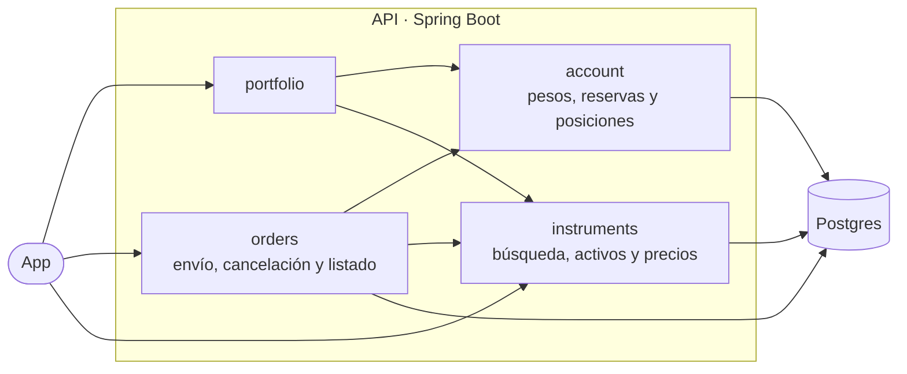

# 03 — RFC: cómo se construye la API

> Fase 3 · 2026-11-07 · Estado: **en construcción, por secciones**
>
> El PRD ([`02-prd.md`](02-prd.md)) dice qué tiene que hacer la API; este documento dice cómo se construye. Cubre lo
> que el PRD dejó para esta fase (su sección 6) y los cambios a la base que quedaron pendientes en
> [`01-decisiones.md`](01-decisiones.md). Los códigos entre paréntesis remiten a esos documentos: A-4 o R-2, al
> análisis; ENV-9 o GEN-1, al PRD. Cada decisión grande tiene además un ADR en la carpeta [`adr/`](adr/), con las
> opciones que se evaluaron. La sección 12 reúne las decisiones de esta fase.

## Resumen

_Se escribe al final, con todo decidido: el diseño en media página y un diagrama de quién llama a quién._

## 1. Contexto y principios

**Qué se construye.** Una API HTTP en Java con cinco funciones: portfolio, búsqueda de activos y envío de órdenes,
que pide el enunciado, más cancelación y listado de órdenes, que se agregaron en el análisis (A-7). Trabaja sobre la
base que mandó Cocos: usuarios, instrumentos, precios y órdenes. Qué hace cada función, y con qué casos se prueba,
está en el PRD. Esta sección junta lo que condiciona el cómo y los criterios para decidirlo.

**Lo que condiciona el diseño**

| Condición | De dónde sale | Qué implica |
|---|---|---|
| **Java** | el mail de Cocos, que pisa el Node.js del enunciado (C-1) | el lenguaje está dado; el framework y las librerías se eligen en la sección 2 |
| **Se ejecuta localmente con un comando** | el mail, GEN-2 | todo se levanta con `docker compose up`, y alcanza con tener Docker |
| **La base ya existe y tiene datos** | el enunciado; `database.sql`, idéntico a Neon: 4 usuarios, 66 instrumentos, 126 precios y 11 órdenes | se cambia con migraciones y solo donde se justifica. Los datos heredados no se corrigen (D-1, D-4, D-6), así que cada regla nueva tiene que convivir con los que ya están |
| **Neon se trata como producción** | "Base de Neon" | la API y los tests corren contra una copia local en Postgres 18, la misma versión mayor que Neon; los tests nunca tocan Neon. La dirección de la base se configura, y si a Neon se le aplican las migraciones se decide en la fase 8 |
| **Sin autenticación** | el enunciado (S-5) | el número de usuario viaja en cada pedido; en producción saldría de la sesión |
| **No se simula el mercado** | el enunciado | una orden a mercado se resuelve en el momento, al último precio; una límite aceptada queda pendiente hasta que el usuario la cancela. No hay horario de mercado ni vencimientos |
| **Hoy hay 11 órdenes, pero el diseño tiene que aguantar volumen** | "Esquema: se mejora", A-4, A-7, GEN-8 | cada consulta se piensa para mucho volumen y se mide, como en el análisis, con un millón de órdenes |
| **Test funcional del envío** | el enunciado, GEN-3 | el envío se prueba de punta a punta contra una base real, con los casos del PRD |

**Principios**

Cuando hay que elegir entre opciones que cumplen el PRD, se decide con estos criterios. El orden importa: si dos
chocan, gana el de más arriba.

1. **La plata y las acciones nunca se gastan dos veces,** ni con dos órdenes al mismo tiempo (R-1) ni con un
   reintento (R-2). Es el riesgo más serio del challenge: la orden 11, que dejó BMA en −10, es el síntoma exacto de
   dos ventas simultáneas sin bloqueo (D-1). Una opción más simple que deje abierta esa puerta no sirve.
2. **Nunca se cambia lo que el usuario autorizó.** Un precio con más de 2 decimales se rechaza en vez de redondearse
   (D-4), y en una orden por monto la cantidad se corta para abajo, así nunca supera lo pedido (A-6).
3. **La base no acepta datos imposibles.** Las reglas que se ven en una sola fila, como una orden sin usuario o un
   lado que no existe (`side = 'COMPRA'`), van en la base. Las que necesitan sumar muchas filas, como "no vender más
   de lo que se tiene", van en el código (D-1).
4. **Cada dato vive en un solo lugar.** Las posiciones se calculan desde las órdenes y no se copian a otra tabla, así
   no hay dos versiones que puedan diferir (A-4).
5. **Lo que se afirma, se mide o se prueba.** Un índice entra con su medición antes y después (A-4, A-7), y los casos
   del PRD son la base de los tests (sección 10).
6. **Lo simple gana.** Entre dos opciones que cumplen lo anterior, va la más simple. Cada capa, patrón o librería
   extra se justifica en un ADR, o no entra (`CLAUDE.md`).

## 2. Arquitectura

**Versiones**

| Pieza | Versión | Por qué |
|---|---|---|
| Java | 25, de soporte largo (LTS) | Es la LTS vigente, con soporte hasta septiembre de 2031. La anterior, 21, también serviría, pero su soporte termina en diciembre de 2029. Las que salieron después, 26 y 27, no son LTS y duran 6 meses |
| Spring Boot | 4.1 (la 4.1.2 al 2026-11-07) | Es la línea estable, con soporte gratuito hasta julio de 2027. La 3.5 lo perdió en junio de 2026, la 4.0 lo pierde en diciembre y la 4.2 todavía está en prueba |
| Postgres | 18 | La misma versión mayor que Neon (18.6) |

Encajan entre sí: Spring Boot 4.1.2 pide Java 17 o más y soporta hasta Java 27, y JaCoCo, que mide la cobertura
(sección 10), soporta Java 25 desde su versión 0.8.14. Verificado el 2026-11-07 en endoflife.date
([Spring Boot](https://endoflife.date/spring-boot), [Temurin](https://endoflife.date/eclipse-temurin)), en los
[requisitos de Spring Boot](https://docs.spring.io/spring-boot/system-requirements.html), en los anuncios de la 4.2
([M2](https://spring.io/blog/2026/09/25/spring-boot-4-2-0-M2-available-now/),
[RC1](https://infoq.com/news/2026/10/spring-news-roundup-oct19-2026)) y en los
[cambios de JaCoCo](https://www.jacoco.org/jacoco/trunk/doc/changes.html).

**Por qué Spring Boot.** Trae resuelto casi todo lo que pide la vara de calidad de `CLAUDE.md`: validación de lo que
llega (Bean Validation), errores con formato estándar (Problem Details), métricas (Micrometer y Actuator), logs
estructurados, transacciones, acceso a la base con `JdbcClient` y tests contra un Postgres real con Testcontainers.
Quarkus y Micronaut arrancan más rápido y usan menos memoria: son ventajas cuando se levantan y apagan muchas
instancias por minuto, no en una API que queda corriendo.

**Estilo: capas, agrupadas por función** ([ADR 0001](adr/0001-capas-por-funcion.md))

Cada función tiene tres capas, y cada capa hace una sola cosa:

| Capa | Qué hace | Qué no hace |
|---|---|---|
| controller | recibe el pedido HTTP, valida su forma y arma la respuesta | no aplica reglas de negocio ni toca la base |
| service | abre la transacción, aplica las reglas y decide el resultado, por ejemplo `FILLED` o `REJECTED` | no escribe SQL ni conoce HTTP |
| repository | ejecuta el SQL y convierte cada fila en un record de Java | no decide nada |

- **Los cálculos van en clases de Java puro,** sin Spring ni base: pesos disponibles, PPC, rendimiento, cantidad por
  monto y reservas. Se prueban con tests unitarios, rápido y caso por caso.
- **La cuenta del usuario se calcula en un solo lugar,** el paquete `account`: pesos, reservas, disponibles y
  posiciones. La usan el portfolio y el envío (principio 4). Si cada uno tuviera su fórmula, el portfolio podría
  mostrar $627.500 disponibles y el envío validar contra otro número. Si se calcula en la base o en Java se decide en
  la sección 4.
- **El catálogo de activos y sus precios viven en `instruments`,** junto con la búsqueda: el portfolio, el envío y la
  búsqueda leen el último precio del mismo lugar.
- **Lo común** (el formato de los errores, el id de cada pedido y la configuración) va en `shared`.
- **Las dependencias van en un solo sentido:** controller → service → repository, y de cada función hacia `account` e
  `instruments`, nunca al revés. Los cálculos no dependen de nada.

`shared` no aparece en el diagrama porque lo usan todos.

**Por qué no hexagonal** (ni Clean Architecture, que sigue la misma idea). Sus interfaces ("puertos") sirven para
cambiar lo de afuera sin tocar el núcleo, y acá lo único de afuera es la base. Lo más delicado, la transacción del envío, se prueba contra Postgres real de todas formas.
Cambiaría si la API mandara órdenes a un mercado real: ahí se agrega un puerto para el mercado, no toda la
arquitectura.

**Acceso a datos: SQL directo con `JdbcClient`** ([ADR 0002](adr/0002-sql-directo-con-jdbcclient.md))

Cada repository escribe su SQL con `JdbcClient`, que viene con Spring: Spring maneja las conexiones, los parámetros y
las transacciones, y convierte cada fila en un record. Las transacciones se marcan en los services. El SQL verificado
en el análisis es el punto de partida.

**Por qué no JPA.** Las consultas importantes de esta API (sumas con condiciones, `unaccent`, el cursor, los
bloqueos) terminarían en SQL nativo igual, y JPA agrega comportamiento escondido justo en el camino más delicado. Por
ejemplo, cancelar en un solo paso (A-7) es un `UPDATE ... WHERE status = 'NEW'`; con JPA, lo habitual es leer la
orden, cambiarla en memoria y grabarla al confirmar. jOOQ validaría el SQL al compilar, pero obliga a generar código
en cada build: para unas 10 consultas no se justifica.

**Recorrido de un pedido**

El envío de una orden es el recorrido más completo:

1. **Llega el pedido.** Un filtro le asigna un id, que acompaña a todos los logs de ese pedido (sección 8).
2. **El controller valida la forma:** que estén los datos y con valores válidos, que venga la cantidad o el monto (uno
   de los dos), que la cantidad sea entera y mayor a 0, que montos y precios sean mayores a 0 y con hasta 2 decimales,
   y que la combinación tenga sentido (una límite lleva precio; una a mercado, no). Si algo falla, responde 400 con el
   error en formato estándar (sección 7), y no se graba nada.
3. **El service abre una transacción** y, dentro de ella:
   1. toma el turno del usuario, para que sus órdenes se procesen de a una (sección 5);
   2. se fija si el identificador de la orden ya existe: si es un reintento con el mismo contenido, devuelve la orden
      original, y con otro contenido, da error (sección 5);
   3. le pide la cuenta del usuario a `account` y el activo con su último precio a `instruments`;
   4. si con esos datos no se puede armar la orden (el activo no existe o es ARS, o por monto la cantidad da 0), da
      error y no graba nada (A-6). Si se puede, los cálculos deciden el resultado: `FILLED`, `NEW` o `REJECTED`, con
      su motivo;
   5. graba la orden.
4. **Los repositories** ejecutan cada paso en SQL, dentro de esa misma transacción.
5. **El controller responde** con la orden y su estado (sección 6), y las métricas la cuentan por tipo, lado y estado
   (sección 8).

**Qué queda para el plan.** Este RFC fija los paquetes, qué hace cada capa y las reglas que el código tiene que
cumplir. Las clases y los archivos concretos los define el plan de implementación (fase 4), tarea por tarea y con el
test de cada una primero.

## 3. Modelo de datos y cambios a la base

_Pendiente._ Cada punto de "Pendientes acumulados para el bloque del esquema" (`01-decisiones.md`), decidido:
columnas nuevas (el identificador, el motivo del rechazo y lo que haga falta para reconocer un reintento), reglas,
índices con su medición antes y después, y `datetime` con zona horaria. Cómo se aplican las migraciones a una base
que ya tiene datos y no tiene historial de migraciones, como la de Neon. Diagrama del modelo.

## 4. Cálculos y consultas

_Pendiente._ Si cada número (portfolio, reservas, cantidad por monto) se calcula en la base o en Java. Cómo se arman
la búsqueda y la paginación del listado. Precisión y modo de redondeo (GEN-7).

## 5. Órdenes simultáneas y reintentos

_Pendiente._ Cómo se procesan de a una las órdenes de un usuario (GEN-1), cómo se reconoce un reintento (ENV-9, R-2)
y cómo convive todo eso con la cancelación. Diagramas: los estados de una orden, dos compras al mismo tiempo y un
reintento.

## 6. Contratos de la API

_Pendiente._ Las direcciones de las 5 funciones, con pedidos y respuestas de ejemplo con los números del usuario 1;
códigos HTTP; formato de fechas (ENV-8); el identificador de orden: nombre, largo y si va en el cuerpo o en un
encabezado (ENV-9); la paginación; los números configurables (BUS-5, BUS-6, LIS-3); si se publica la especificación
OpenAPI.

## 7. Errores y validación

_Pendiente._ El formato estándar (Problem Details, RFC 9457), el catálogo de errores con un ejemplo de cada uno
(GEN-6), y por qué un `REJECTED` no es un error.

## 8. Observabilidad

_Pendiente._ Logs con el id de cada pedido y sin email (GEN-5); métricas de negocio y técnicas, y cómo se muestran
(GEN-4); el objetivo de tiempo de respuesta, medido con volumen (GEN-8).

## 9. Seguridad

_Pendiente._ Sin autenticación y cómo se agregaría (S-5); validación en el borde; consultas parametrizadas; secretos
por variables de entorno.

## 10. Estrategia de tests

_Pendiente._ Los niveles: unitarios, integración contra Postgres real y el funcional del envío (GEN-3). Cómo arranca
cada caso desde los datos originales y cómo se prueban los casos simultáneos. El piso de cobertura. Resuelve el
choque entre D-8.4 ("cada test arma sus propios datos") y los casos del PRD que escriben sobre el usuario 1.

## 11. Construcción, ejecución y entrega

_Pendiente._ Maven; las convenciones de código (código limpio) y las herramientas de formato y de análisis estático
que las hacen cumplir y frenan el build; CI en GitHub Actions;
Docker y `docker compose up` (GEN-2); la configuración; la colección de Postman; la herramienta del portal. Diagrama
de cómo se levanta todo.

## 12. Decisiones de esta fase y ADR

**Decisiones de esta fase**

| Decisión | Por qué | Dónde |
|---|---|---|
| Los documentos se escriben en Markdown, que es la única fuente, con los diagramas en Mermaid. El portal HTML de la fase 7 se genera desde esos archivos | GitHub muestra el Markdown formateado y dibuja los diagramas, y cada cambio se lee en su PR. Un HTML escrito a mano se vería como código en GitHub y se desincronizaría del Markdown | `CLAUDE.md`, "Decisiones abiertas" |
| Java 25 y Spring Boot 4.1 | son las versiones estables con más soporte, y funcionan juntas | sección 2 |
| Capas agrupadas por función, no hexagonal | lo único de afuera es la base, y lo delicado se prueba contra Postgres real igual | sección 2, ADR 0001 |
| SQL directo con `JdbcClient`, no JPA ni jOOQ | las consultas importantes son SQL propio de Postgres, y el camino más delicado no puede tener comportamiento escondido | sección 2, ADR 0002 |
| La cuenta del usuario se calcula en un solo lugar (`account`), que usan el portfolio y el envío | si cada uno tuviera su fórmula, podrían mostrar y validar números distintos (principio 4) | sección 2, ADR 0001 |

**ADR**

En la carpeta [`adr/`](adr/), un archivo corto por decisión, con contexto, opciones, decisión y consecuencias:

- [ADR 0001 — Capas agrupadas por función, no hexagonal](adr/0001-capas-por-funcion.md)
- [ADR 0002 — SQL directo con `JdbcClient`, no JPA](adr/0002-sql-directo-con-jdbcclient.md)

Candidatos que faltan: posiciones calculadas (el que dejó pendiente A-4), órdenes de un usuario de a una, cómo se
reconoce un reintento, migraciones sobre una base con datos y cómo se muestran las métricas.
