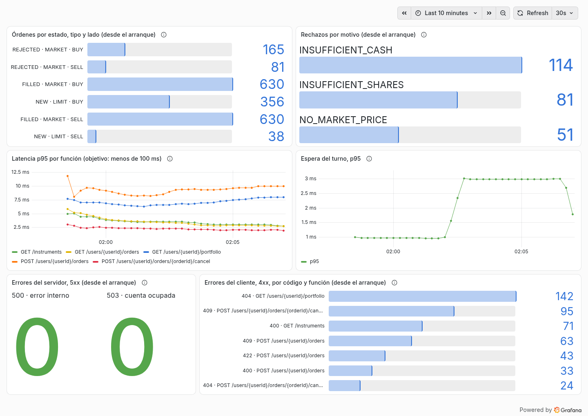

# Métricas

Qué mide la API, dónde se ve y qué dio al medirla con volumen.

## El tablero

Con todo levantado está en Grafana, en <http://localhost:3000>. Es la página de inicio y no pide usuario ni clave.

La captura es de la API corriendo en local, después de diez minutos de tráfico de ejemplo: los números cambian en cada
corrida. El tráfico trae errores del cliente a propósito. Y durante un minuto, desde las 02:01:40, manda tres órdenes del
mismo usuario a la vez: se ve en la espera del turno, que pasa de 1 ms a 3 ms. Sigue así cinco minutos y después baja,
porque cada punto mira los últimos cinco minutos.

Cada panel explica qué muestra en la "i" que está al lado de su título.

--8<-- "03-rfc.md:tablero"

**Los errores van en dos paneles porque no significan lo mismo.** Un error del cliente (4xx) es la API diciéndole que no
a un pedido que no se podía cumplir: la API funcionó. Un error del servidor (5xx) es una falla de la API: su panel está
en verde mientras marca 0, y pasa a rojo con la primera.

Los cuatro paneles que cuentan muestran todo lo que pasó desde que arrancó la API, desde el primer pedido. Los dos de
líneas miran los últimos 5 minutos y necesitan dos lecturas de Prometheus, que lee cada 15 segundos: la latencia de una
función aparece desde su segundo pedido, con al menos 15 segundos entre los dos.

## Qué mide la API

En texto, tal como las lee Prometheus, están en <http://localhost:8080/actuator/prometheus>.

--8<-- "03-rfc.md:metricas"

Por qué estas y cómo se eligió mostrarlas: [RFC, sección 8](../03-rfc.md#8-observabilidad) y
[ADR 0007](../adr/0007-metricas-con-prometheus-y-grafana.md).

## El tiempo de respuesta

El objetivo es un percentil 95 por debajo de 100 ms en las cinco funciones, con 2 millones de órdenes en la tabla y
usuarios de hasta 10.000 órdenes ([RFC, sección 8.4](../03-rfc.md#84-el-objetivo-de-tiempo-de-respuesta-gen-8)). Cada
escenario manda 10 pedidos por segundo durante un minuto:

--8<-- "mediciones/06-tiempo-de-respuesta.md:resultado-volumen"

Es una carga moderada, en una computadora de escritorio y con la base en memoria: sirve como orden de magnitud, y no
dice cuántos pedidos aguanta la API. La máquina, los datos, los límites y cómo repetirla están en
[la medición completa](../mediciones/06-tiempo-de-respuesta.md).

## Qué se alertaría

No hay alertas construidas: en una corrida local no hay a quién avisarle. Con estas mismas métricas, se alertaría esto:

--8<-- "03-rfc.md:alertas"

El criterio, sus números y de dónde sale: [RFC, sección 8.5](../03-rfc.md#85-qué-se-alertaría).

## En producción, con New Relic

Se cambia el registro de Micrometer por `micrometer-registry-new-relic`, con la clave y la cuenta por variables de
entorno. Las métricas y su código no cambian.
